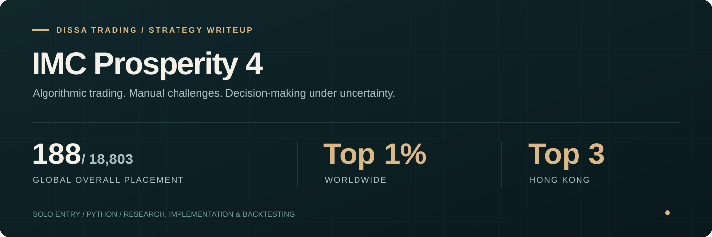

# Dissa Trading — IMC Prosperity 4

**Solo participant · 188th / 18,803 teams · Top 1% globally · Top 3 in Hong Kong**

I competed independently in IMC Prosperity 4 as **Dissa Trading**, taking responsibility for strategy research, Python implementation, backtesting, and manual-trading decisions. I finished **188th overall** and **within Hong Kong's top three**.

This portfolio combines the Round 3–5 algorithms with a retrospective analysis of all five manual challenges. The code covers market making, options valuation, and statistical pairs; the manual chapter examines auction execution, crowd-dependent decisions, derivatives, and news-driven allocation.

[Algorithmic strategies](#algorithmic-strategies-at-a-glance) · [Manual challenges](#manual-challenges--five-different-decisions) · [My contribution](#my-contribution) · [Technical reference](docs/strategy-reference.md) · [Source code](strategies)

## My contribution

As a solo entrant, I handled the complete competition workflow:

- **Research:** investigated product behavior and designed the trading signals and decision rules.
- **Implementation:** wrote and integrated the Python traders, including pricing, order placement, inventory controls, and persistent state.
- **Backtesting:** evaluated candidate strategies during development and used the results to inform submissions.
- **Manual trading:** made the manual-challenge decisions alongside the algorithmic submissions.

The overall placement includes the competition's algorithmic and manual components. IMC reports **18,803 participating teams** on its [official website](https://prosperity.imc.com/). [Results and scope](docs/results-and-scope.md)

## Algorithmic strategies at a glance

| Round | Strategy | Trading judgment |
|---|---|---|
| **3** | Passive market making using order-book signals and inventory-sensitive quotes | Balance spread capture against the risk of accumulating a one-sided position |
| **4** | Anchored underlying valuations, trader-flow signals, and option relative value | Separate an option-pricing opportunity from a directional view on the underlying |
| **5** | Selective market making, momentum and delayed signals, and statistical pairs | Choose where to provide liquidity and when a relationship warrants taking liquidity |

## Round 3 — Market making with inventory discipline

**Objective:** buy below estimated fair value and sell above it, earning the difference when both sides trade.

I combined three signals to estimate value for Hydrogel and Velvet: large orders in the book, buying/selling pressure at the best prices, and a smoothed midpoint history. The bot posts competitive orders inside sufficiently wide spreads, provided each quote leaves a minimum margin around fair value.

Inventory changes both willingness to trade and order size. As a position grows, quotes become smaller and the bot stops adding in that direction. At higher thresholds, small immediate trades reduce exposure.

The round also prices a low-strike voucher approximately as **Velvet fair value minus its strike**, and places zero-price bids on distant-strike vouchers. It does not use an implied-volatility model.

**Tradeoff:** more fills are not automatically better. A profitable-looking spread can become a losing position if only one side executes before the market moves.

[Source](strategies/round_3.py) · [Formulas, parameters, and example](docs/strategy-reference.md#3-round-3-passive-external-flow-market-making)

## Round 4 — Options valuation and conditional risk-taking

**Objective:** compare underlying and option prices against model-based reference values, then act when the entry conditions agree.

The implementation combines three components:

1. **Underlying fair values.** Blend fixed price anchors with recent median prices. Decaying scores for named buyers and sellers adjust the reference values according to their interpreted directional information.
2. **Option relative value.** Invert Black–Scholes to infer implied volatility from voucher prices, fit a quadratic curve across strikes, and convert the fitted volatility back into an option fair value. Each target option is excluded from its own fit. The curve can represent volatility **smile** and **skew**.
3. **Conditional call shorts.** Sell central-strike calls when Velvet looks rich against adjusted fair value, the flow score permits selling, and the calls are not too cheap against the option model. Cover as the underlying reverts, flow turns strongly bullish, or the options become sufficiently cheap.

Implied volatility expresses the uncertainty embedded in an option price. Comparing it across strikes provides a reference for judging whether an option differs from its neighbors.

**Tradeoff:** the short-call overlay carries directional and volatility exposure. Positions are constrained, but the implementation does not explicitly delta-hedge the calls and uses a fixed four-day expiry assumption.

[Source](strategies/round_4.py) · [Black–Scholes and IV fitting](docs/strategy-reference.md#45-step-4-infer-implied-volatility-with-blackscholes)

## Round 5 — Product selection and statistical relationships

**Objective:** adjust the trading approach to product behavior rather than quote every product identically.

The strategy covers a 50-product universe, with ten excluded from ordinary market making. For the remaining products, quotes respond to inventory and recent momentum. Microchip Oval and Triangle also use movement in Microchip Circle over preset historical periods as a leading signal.

Two separate pair strategies track **Rectangle/Pebbles XS** and **Square/Robot Ironing**. They compare each weighted price spread with a slowly adapting mean and variance, enter when deviations exceed specified z-score thresholds, and target flat positions after reversion. These pair trades take available liquidity rather than wait for passive fills.

**Tradeoff:** the price weights define the signals, but actual pair positions use equal unit quantities. The legs execute separately, so the trades can carry unmatched exposure and should not be described as guaranteed market-neutral arbitrage.

[Source](strategies/round_5.py) · [Signals, pair targets, and execution](docs/strategy-reference.md#57-step-6-calculate-statistical-pair-spreads)

## Manual challenges — five different decisions

I also handled the manual submissions as a solo participant. Exact submission records are unavailable, so the chapter below presents **retrospective challenge analysis**, with proposed analytical methods distinguished from recorded submissions.

| Round | Challenge | Central decision |
|---|---|---|
| **1** | Auction execution | Balance order size against its effect on clearing and fills |
| **2** | Capital allocation | Separate known returns from a reward dependent on competitors |
| **3** | Two-stage bidding | Balance purchase margin against a crowd-dependent penalty |
| **4** | Derivatives portfolio | Match valuation to contract rules and executable prices |
| **5** | News-driven allocation | Translate a return view into size after trading costs |

The [manual chapter](docs/manual-rounds.md) explains each problem, an analytical approach, its main risk, and a question a trader might ask about the decision.

## Research and validation

I used backtesting during strategy development. This archive contains the final supplied code and its operating logic; it does not include the underlying market-data archive or recorded replay outputs. It therefore supports inspection of the algorithms, but does not provide a reproducible performance study or isolate each component's contribution to the final rank.

The technical reference distinguishes implemented behavior from comments describing historical tests. It also records details that matter when assessing results: submitted orders are not confirmed fills, option exits depend on usable model inputs, and pair legs may execute unevenly.

## Connecting the models to trading decisions

The code makes the relationship between valuation, execution, and risk explicit: Round 3 changes quotes as inventory grows; Round 4 distinguishes option relative value from directional call exposure; Round 5 chooses between passive quotes and aggressive pair execution.

The manual analysis extends that discussion to decisions with different sources of uncertainty. A known payoff can still depend on execution rules, competitors, a contract's observation schedule, or the reliability of a news interpretation. The important distinction is what the rules determine and what remains an assumption.

## What I would improve next

- **Validation evidence:** package replay inputs and outputs, compare each signal against a simpler baseline, and test sensitivity to fills, execution costs, and parameter changes.
- **Option risk:** use an advancing expiry clock and monitor aggregate delta, gamma, and vega across strikes before evaluating a hedging policy.
- **Pair execution:** evaluate quantities consistent with the spread coefficients and impose liquidity-aware execution limits on each leg.

These are proposed extensions, not claims about features in the archived submissions.

## Explore the implementation

| Resource | Contents |
|---|---|
| [Technical strategy reference](docs/strategy-reference.md) | Step-by-step logic, formulas, parameter tables, worked examples, and implementation limitations |
| [Manual challenge analysis](docs/manual-rounds.md) | All five rounds, analytical frameworks, risks, and discussion questions |
| [Python strategies](strategies) | Original Round 3, 4, and 5 trader files |
| [Running the code](docs/running-the-code.md) | Competition runtime requirements and replay prerequisites |
| [Results and scope](docs/results-and-scope.md) | Ranking basis, solo ownership, and coverage |
| [Source manifest](docs/source-manifest.json) | Original filenames and SHA-256 checksums |

The strategy files are preserved unchanged and require the competition's compatible `datamodel` and a trading engine. They are archived submissions rather than standalone applications.

**Python · market microstructure · market making · Black–Scholes · implied volatility · statistical pairs · inventory management**
